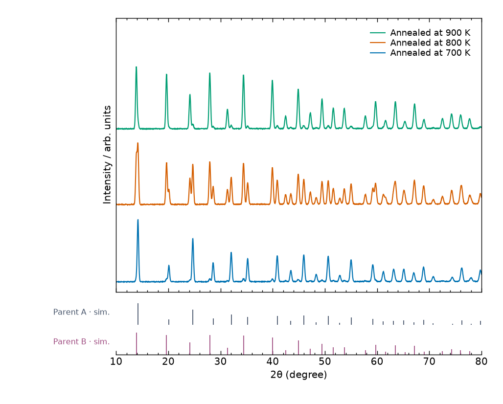
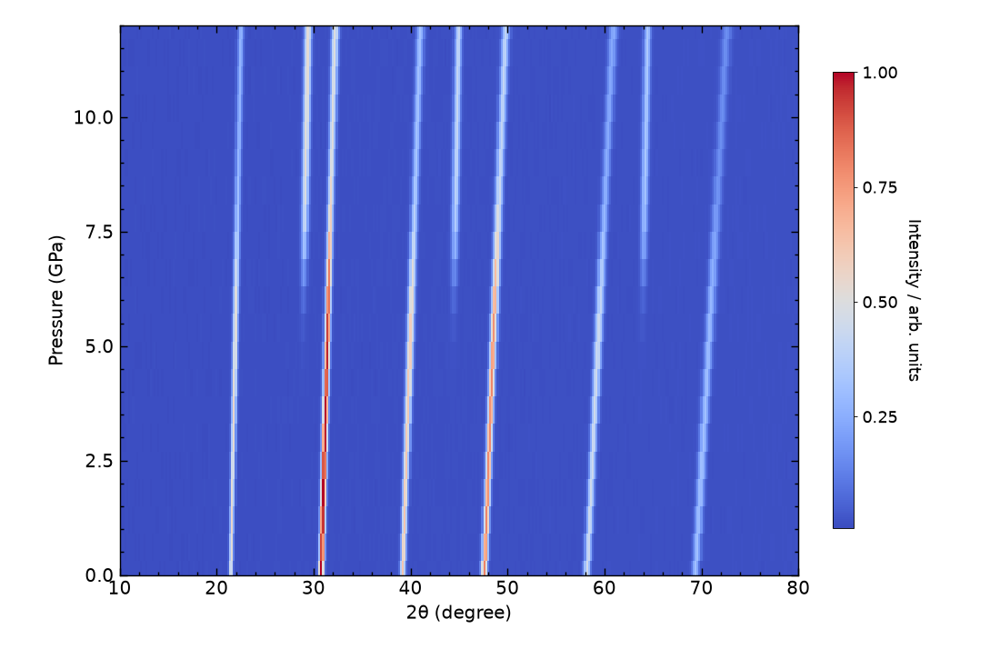

# XRD examples

[日本語](README_ja.md) · [Graph Editor manual](../graph_viewer_manual_en.md)

Both examples use synthetic values from the [public baseline generator](../graph_editor_baselines/solid-state-v2/reproducibility/build_domain_baseline.py).

## Parent-structure comparison

Open **Graph > Create Graph from Template…** in Graph Editor and load the [scans](data/xrd-parent-comparison.csv), [Parent A peaks](data/xrd-parent-a.csv) and [Parent B peaks](data/xrd-parent-b.csv). Choose **XRD stacked scans**, set **Scans** to 3 and **Reference phases** to 2. Name the scans `Annealed at 700 K`, `Annealed at 800 K` and `Annealed at 900 K` and label the reference phases `Parent A` and `Parent B`. Enable **Normalize each scan to 100**. The supplied reference peak heights are illustrative. [MCP recipe](../graph_mcp/examples/xrd-parent-comparison.json)

## Pressure map

Choose **XRD condition map** and load the [pressure series](data/xrd-pressure-map.csv). Use **Pressure (GPa)** as the condition and **Intensity (arb. units)** for the color scale. The CSV keeps existing synthetic values at 0.2° and 0.6 GPa intervals. [MCP recipe](../graph_mcp/examples/xrd-pressure-map.json)

To run either JSON as written, pass it to `create_figure` with a working copy of this directory as the MCP workspace. [MCP setup](../graph_mcp/README.md)
