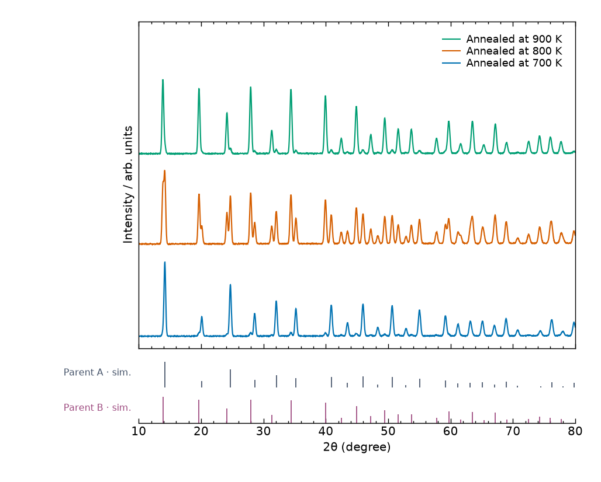
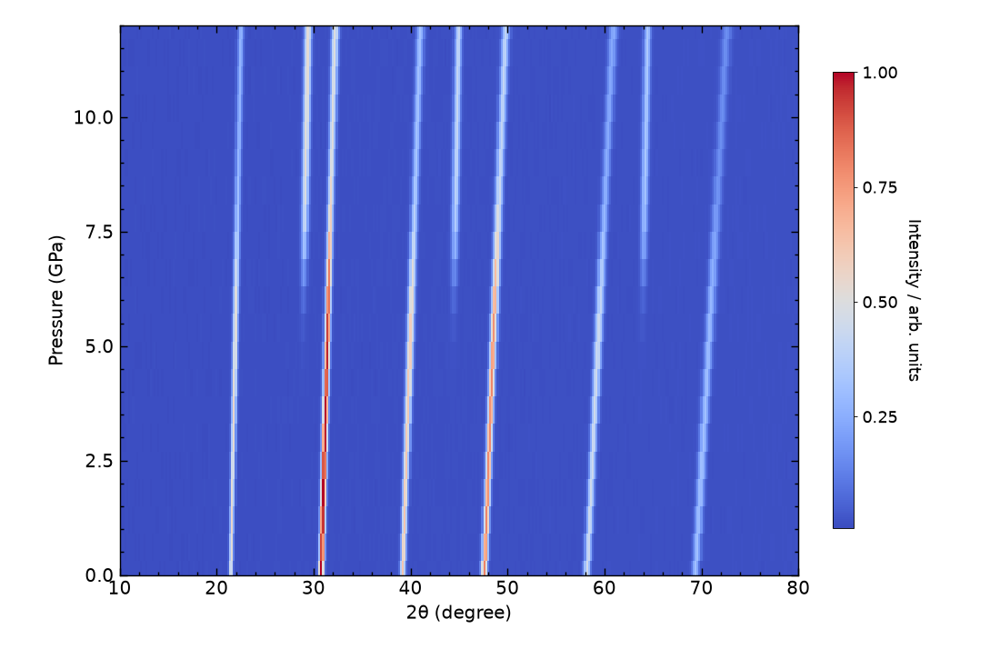

# XRD作図例

[English](README.md) · [Graph Editorマニュアル](../graph_viewer_manual.md)

2例とも公開版の[作図例生成スクリプト](../graph_editor_baselines/solid-state-v2/reproducibility/build_domain_baseline.py)で生成した合成データを使います。

## 母構造比較

Graph Editorの **グラフ > テンプレートから作図…** で、[スキャン](data/xrd-parent-comparison.csv)、[母構造Aのピーク](data/xrd-parent-a.csv)、[母構造Bのピーク](data/xrd-parent-b.csv)を読み込みます。**XRD 縦積み** を選び、**スキャン数** を3、**参照相の数** を2にします。凡例を `Annealed at 700 K`、`Annealed at 800 K`、`Annealed at 900 K`、相名を `Parent A` と `Parent B` にし、**各スキャンの最大値を100に規格化** をオンにします。参照ピークの相対強度は作例用です。[MCPレシピ](../graph_mcp/examples/xrd-parent-comparison.json)

## 圧力マップ

**XRD 条件マップ** を選び、[圧力系列のCSV](data/xrd-pressure-map.csv)を読み込みます。**Pressure (GPa)** を条件値、**Intensity (arb. units)** を強度に指定します。元の合成データから2θを0.2°、圧力を0.6 GPa間隔で抽出しています。[MCPレシピ](../graph_mcp/examples/xrd-pressure-map.json)

MCPで試す場合は、このフォルダの作業用コピーを `--workspace` に指定し、対応するJSONを `create_figure` に渡します。[MCPの起動手順](../graph_mcp/README_ja.md)
